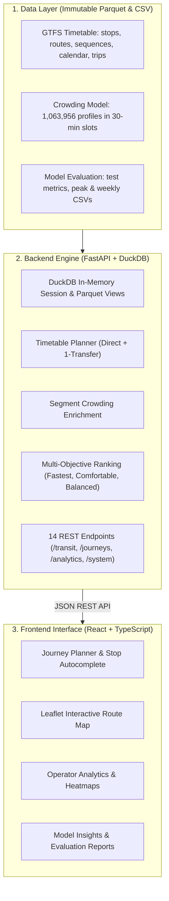

# 🚍 CrowdSense — Delhi Bus Crowdedness-Aware Journey Planner

[](https://colab.research.google.com/github/devansh-g10/CrowdSense/blob/main/notebooks/CrowdRoute_Delhi_ML_Pipeline.ipynb)


**CrowdSense (CrowdRoute Delhi)** is an end-to-end, crowdedness-aware public bus transit planning and analytics platform designed specifically for the Delhi bus network (DTC & DIMTS).

Traditional navigation platforms optimize strictly for the shortest travel time or minimal distance. CrowdSense combines **static GTFS transit timetables** with **historical conductor/ETIM ticketing data** to give commuters transparent choices: balancing travel time against relative crowdedness so riders can choose a slower, significantly more comfortable bus over an overcrowded one.

---

## 🌟 Key Features

- **🚍 Commuter Journey Planner**: Direct routes and 1 same-stop transfer timetable planning across Delhi's 6,862 bus stops and 2,574 routes.
- **⚖️ Multi-Objective Recommendation Engine**:
  - **Fastest**: Minimizes total travel duration (wait + in-vehicle time).
  - **Comfortable**: Requires $\ge 80\%$ reliable data coverage and minimizes relative crowding score.
  - **Balanced**: Transparently balances travel duration, crowding penalty, and transfer convenience.
- **🗺️ Interactive Route Map**: Powered by Leaflet & OpenStreetMap. Displays source, destination, transfer points, and segments color-coded by historical crowding levels (**Low**: Green, **Moderate**: Amber, **High**: Red, **Insufficient Data**: Gray).
- **📊 Transport Operator Dashboard**: Provides transit authorities with a 48-slot half-hour crowding intensity heatmap, high-crowding segment leaderboards, peak-hour load comparisons, and 5-week stability trends using Recharts.
- **⚡ In-Memory Analytics with DuckDB**: Zero persistent SQL database servers. Directly executes bounded SQL queries over immutable Parquet files with 256 MB RAM limits and disk-spill safeguards.
- **🔬 Model Insights & Methodology**: Openly presents held-out evaluation metrics (MAE 0.4686, RMSE 0.9216, 90.97% within 1 passenger) and clearly explains data limitations.

---

## 🏗️ System Architecture



---

## 📁 Repository Structure

```text
CrowdSense/
├── backend/                  # FastAPI backend application
│   ├── api/                  # Modular routers (transit, journeys, analytics, system)
│   ├── config.py             # Settings, paths, and resource limits
│   ├── database.py           # DuckDB in-memory query engine & Parquet views
│   ├── journey_planner.py    # GTFS static timetable search engine
│   ├── journey_crowding.py   # Historical segment crowding join & coverage
│   ├── journey_ranking.py    # Multi-objective journey ranking policy
│   ├── main.py               # FastAPI application entry point
│   └── schemas.py            # Pydantic data validation models
├── frontend/                 # React 18 + Vite + TypeScript frontend
│   ├── src/
│   │   ├── Planner.tsx       # Commuter journey search with stop autocomplete
│   │   ├── JourneyResults.tsx# Journey cards, crowding badges, itinerary
│   │   ├── RouteMap.tsx      # Leaflet interactive map with crowding polylines
│   │   ├── Operator.tsx      # Operator dashboard with filters
│   │   ├── OperatorCharts.tsx# Heatmaps, peak-hour & weekly Recharts
│   │   ├── ModelInsights.tsx # Model performance & test comparison metrics
│   │   └── About.tsx         # System methodology & data limitations
│   └── vite.config.ts        # Vite configuration with API proxying
├── notebooks/                # Google Colab ML Pipeline
│   └── CrowdRoute_Delhi_ML_Pipeline.ipynb
├── tests/                    # Automated integration test suite (86 tests)
│   ├── test_api.py           # API endpoint integration tests
│   ├── test_database.py      # DuckDB Parquet query tests
│   ├── test_journeys.py      # Timetable journey planning tests
│   └── test_journey_crowding.py # Crowding & ranking tests
├── scripts/                  # Data audit & verification scripts
├── docs/                     # Technical specifications & phase verification reports
├── requirements.txt          # Python root dependencies
└── README.md                 # Project documentation
```

---

## 🚀 Getting Started

### Prerequisites
- **Python**: 3.12 or higher
- **Node.js**: 18.0 or higher (`npm` included)

---

### 1. Backend Setup

From the repository root:

```bash
# 1. Create and activate a virtual environment
python -m venv .venv

# Windows (PowerShell):
.venv\Scripts\Activate.ps1
# Linux / macOS:
source .venv/bin/activate

# 2. Install dependencies
pip install -r requirements.txt

# 3. Start the FastAPI local server
python -m uvicorn backend.main:app --host 127.0.0.1 --port 8000 --reload
```

Once running, access:
- **Interactive Swagger API Docs**: [http://127.0.0.1:8000/docs](http://127.0.0.1:8000/docs)
- **OpenAPI JSON Specification**: [http://127.0.0.1:8000/openapi.json](http://127.0.0.1:8000/openapi.json)
- **API Health Check**: [http://127.0.0.1:8000/api/health](http://127.0.0.1:8000/api/health)

---

### 2. Frontend Setup

In a separate terminal, navigate to the `frontend/` directory:

```bash
cd frontend

# 1. Install npm packages
npm install

# 2. Run local development server
npm run dev
```

Open the URL provided by Vite (typically `http://localhost:5173`).  
The frontend automatically proxies `/api` calls to `http://127.0.0.1:8000`.

To build the frontend for production:
```bash
npm run typecheck
npm run build
npm run preview
```

---

## 📡 API Reference

The backend provides 14 RESTful GET endpoints:

| Endpoint | Tag | Description |
| :--- | :--- | :--- |
| `GET /api/health` | System | Health check and dataset verification status |
| `GET /api/model-info` | System | Model metadata, training periods, and limitations |
| `GET /api/stops` | Transit | Search 6,862 bus stops with autocomplete |
| `GET /api/routes` | Transit | List routes with agency and descriptor details |
| `GET /api/routes/{route_id}` | Transit | Route detail and associated pattern IDs |
| `GET /api/routes/{route_id}/segments` | Transit | Consecutive stops in each exported route pattern |
| `GET /api/crowding` | Transit | Historical segment crowding profiles by slot & day |
| `GET /api/journeys` | Journeys | Direct & 1-transfer schedule planner with ranking |
| `GET /api/analytics/overview` | Analytics | High-level network KPIs and profile counts |
| `GET /api/analytics/routes` | Analytics | Route-wise profile distribution and average loads |
| `GET /api/analytics/heatmap` | Analytics | 48-slot half-hour crowding intensity matrix |
| `GET /api/analytics/high-segments` | Analytics | Top 10 most congested bus stretches by journey count |
| `GET /api/analytics/weekly` | Analytics | 5-week stability and load distribution summaries |
| `GET /api/analytics/peak-hours` | Analytics | Morning vs. evening peak hour load comparisons |
| `GET /api/analytics/model-performance` | Analytics | Baseline vs. Final model held-out evaluation metrics |

---

## 🧪 Testing & Validation

Run the full automated test suite containing **86 integration tests**:

```bash
# Run all tests via unittest
python -m unittest discover -s tests -v
```

### Live HTTP Verification Scripts
```bash
# Verify API endpoints over live HTTP
python -m scripts.verify_api

# Verify journey planning engine
python -m scripts.verify_journeys

# Verify crowding ranking policy
python -m scripts.verify_crowding_ranking
```

---

## 📊 Machine Learning Model Details

- **Model Type**: *Historical Median with Hourly Fallback* (Version 1.0)
- **Time Slots**: 48 half-hour slots (Asia/Kolkata), partitioned by Weekday vs. Weekend.
- **Classification Strategy**:
  - Training period: Oct 1–21, 2026.
  - Quartiles calculated on training data: $Q_{25}$ and $Q_{75}$.
  - **Low**: Predicted load $< Q_{25}$.
  - **Moderate**: Predicted load between $Q_{25}$ and $Q_{75}$.
  - **High**: Predicted load $> Q_{75}$.
  - **Insufficient Data**: Segments with sparse sample support ($< 5$ trips across $< 3$ days).
- **Test Metrics (Held-out Test: Oct 25–31, 2026)**:
  - **MAE**: 0.4686
  - **RMSE**: 0.9216
  - **Within 1 Passenger**: 90.97%
  - **Prediction Coverage**: 84.66%

> 📓 **Notebook**: Explore the complete data science pipeline in [notebooks/CrowdRoute_Delhi_ML_Pipeline.ipynb](notebooks/CrowdRoute_Delhi_ML_Pipeline.ipynb) or open directly in [Google Colab](https://colab.research.google.com/drive/1fWilipPQfKKYYaOVxITg-KLBGK5dlkyi).

---

## ⚠️ Evidence and Real-World Limitations

1. **Relative Crowding $\ne$ Real-Time Bus Occupancy**: Historical relative crowding reflects past passenger patterns; it does **not** guarantee seat availability or real-time vehicle load.
2. **Preservation of Insufficient Data**: 894,656 profiles carry `Insufficient Data`. The system penalizes unknown segments rather than misinterpreting missing data as an empty bus.
3. **Static GTFS Arrivals**: Delhi GTFS exports provide departure timestamps only. Arrival times and travel durations are calculated approximations using departure proxies.
4. **No Schedule Exception Data**: The GTFS feed does not supply a `calendar_dates.txt` file, meaning holiday cancellations or emergency route modifications cannot be independently verified.

---

## 📄 License

This project was developed for the Delhi Urban Mobility & Transport Hackathon. Open source for public research and transit optimization.
