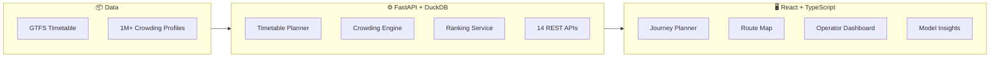

<p align="center">
  
</p>

<h1 align="center">🚍 CrowdSense</h1>
<p align="center"><b>Delhi's Crowdedness-Aware Bus Journey Planner</b></p>

<p align="center">
  <a href="https://colab.research.google.com/github/devansh-g10/CrowdSense/blob/main/notebooks/CrowdRoute_Delhi_ML_Pipeline.ipynb"></a>
  
  
  
  
  
  
</p>

<p align="center">
  <i>Don't just find the fastest bus — find the <b>most comfortable</b> one.</i>
</p>

---

## 💡 The Problem

Delhi commuters pick buses based on travel time alone. But a **10-minute faster bus** that's **packed full** isn't always the better choice. There's no tool that tells you: *"Hey, the next bus is slightly slower but way less crowded."*

## 🎯 Our Solution

CrowdSense merges **25.5 lakh+ ETIM/conductor ticket records** with **GTFS static timetables** to build historical crowding profiles for every bus segment, direction, and time-of-day. Commuters get three choices:

| Preference | What it does |
|:---:|:---|
| ⚡ **Fastest** | Minimum total travel time |
| 🛋️ **Comfortable** | Lowest crowding with ≥80% reliable data |
| ⚖️ **Balanced** | Smart trade-off: time + crowding + transfers |

---

## ✨ Features at a Glance

| Feature | Description |
|:---|:---|
| 🔍 **Smart Stop Search** | Autocomplete across 6,862 Delhi bus stops |
| 🗺️ **Interactive Route Map** | Color-coded segments — Green (Low), Amber (Moderate), Red (High), Gray (Insufficient Data) |
| 📊 **Operator Dashboard** | Heatmaps, peak-hour analytics, weekly trends for DTC/DIMTS planners |
| 🔬 **Model Transparency** | Full evaluation metrics, methodology, and data limitations — nothing hidden |
| 🧪 **86 Integration Tests** | Automated validation across API, database, planning, and ranking |

---

## 🏗️ Architecture



---

## 🚀 Quick Start

### Prerequisites
> Python 3.12+ &nbsp;•&nbsp; Node.js 18+

### Backend
```bash
python -m venv .venv
# Windows: .venv\Scripts\Activate.ps1
# Linux/Mac: source .venv/bin/activate
pip install -r requirements.txt
python -m uvicorn backend.main:app --host 127.0.0.1 --port 8000
```
📄 Swagger Docs → [localhost:8000/docs](http://127.0.0.1:8000/docs)

### Frontend
```bash
cd frontend
npm install
npm run dev
```
🌐 App → [localhost:5173](http://localhost:5173)

---

## 📁 Project Structure

```
├── backend/            → FastAPI + DuckDB query engine + GTFS planner
├── frontend/           → React 18, Vite, TypeScript, Tailwind CSS
├── notebooks/          → Colab ML pipeline (data → model → export)
├── tests/              → 86 automated integration tests
├── scripts/            → Data verification & audit utilities
├── docs/               → Technical specs & verification reports
└── requirements.txt    → Python dependencies
```

---

## 📡 API Endpoints (14 Routes)

| Group | Endpoints |
|:---|:---|
| **System** | `/api/health` · `/api/model-info` |
| **Transit** | `/api/stops` · `/api/routes` · `/api/routes/{id}` · `/api/routes/{id}/segments` · `/api/crowding` |
| **Journeys** | `/api/journeys` — direct + 1-transfer with crowding-aware ranking |
| **Analytics** | `/api/analytics/overview` · `routes` · `heatmap` · `high-segments` · `weekly` · `peak-hours` · `model-performance` |

---

## 📊 Model Performance

| Metric | Value |
|:---|:---:|
| Prediction Coverage | **84.66%** |
| Mean Absolute Error | **0.47** passengers |
| Within ±1 Passenger | **90.97%** |
| Total Profiles | **1,063,956** |
| Time Resolution | **30-min slots** × Weekday/Weekend |

> 📓 Full pipeline → [Open in Colab](https://colab.research.google.com/drive/1fWilipPQfKKYYaOVxITg-KLBGK5dlkyi)

---

## 🧪 Testing

```bash
python -m unittest discover -s tests -v     # 86 tests
python -m scripts.verify_api                 # Live HTTP checks
python -m scripts.verify_journeys            # Journey engine
python -m scripts.verify_crowding_ranking    # Ranking policy
```

---

## ⚠️ Limitations

- Historical crowding ≠ real-time occupancy — no live GPS or passenger counters
- GTFS has departures only — arrival times are approximations
- 84% of profiles are "Insufficient Data" — the system **penalizes** unknowns instead of assuming empty buses
- No holiday exception data in GTFS feed

---

## 👥 Team

Built for the **Delhi Urban Mobility & Transport Hackathon**.

---

<p align="center">
  <b>⭐ Star this repo if you find it useful!</b>
</p>
